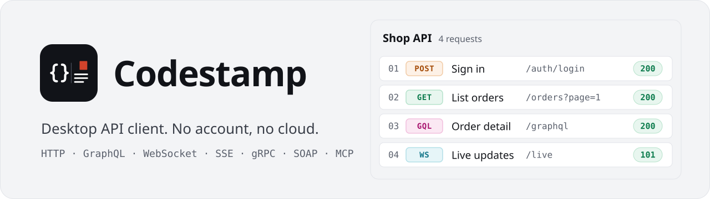
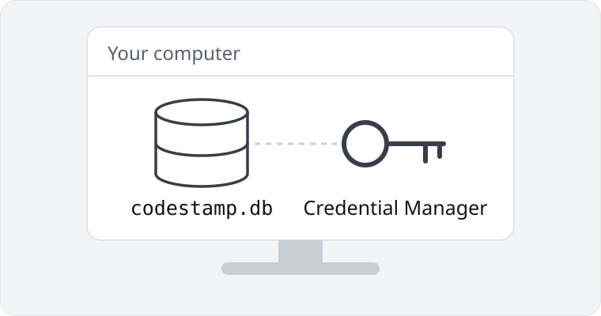
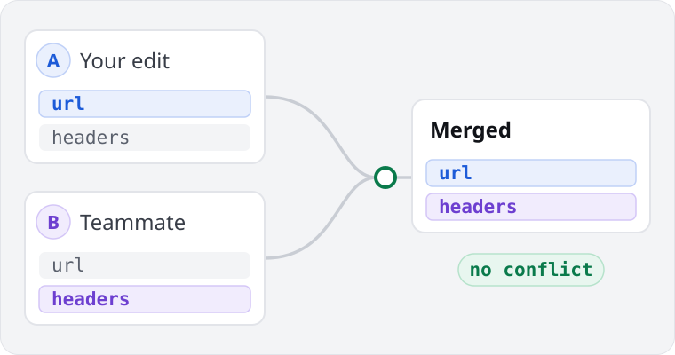
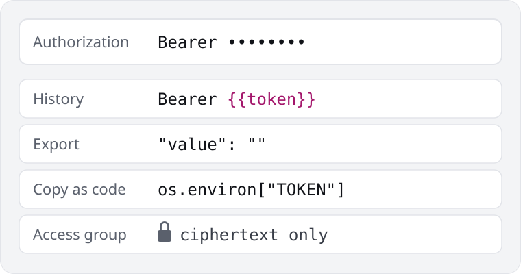
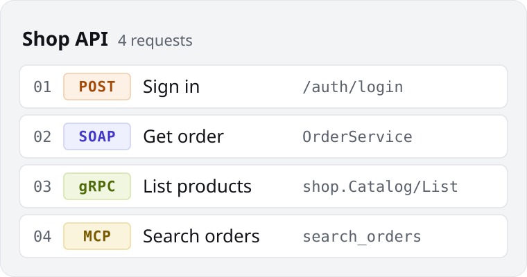
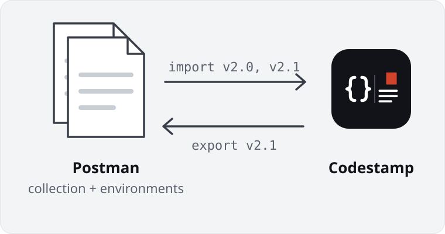
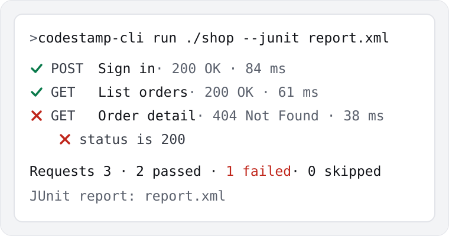

<p align="center">
  <picture>
    <source media="(prefers-color-scheme: dark)" srcset="branding/banner-dark.svg">
    
  </picture>
</p>

<p align="center">
  <a href="LICENSE"></a>
  <a href="../../releases"></a>
  
</p>

<p align="center"><strong>English</strong> · <a href="README.id.md">Bahasa Indonesia</a></p>

Codestamp is a desktop API client for HTTP, GraphQL, WebSocket, Server-Sent Events, gRPC, SOAP and MCP. The network core is written in Rust on Tauri 2, the interface in Svelte 5 and TypeScript, and it runs on the WebView that ships with Windows instead of a bundled browser, so the installer is about 6.5 MB.

Current release: **0.3.7, Windows 10 and 11 (x64)**. macOS and Linux builds are planned.

## What You Need To Know

<table>
  <tr>
    <td width="50%" valign="top">
      <picture>
        <source media="(prefers-color-scheme: dark)" srcset="branding/why/local-dark.svg">
        
      </picture>
      <h3>Your collections stay on your computer</h3>
      <p>There is no account and no cloud. Requests live in a local SQLite database, and Codestamp encrypts secret values with a key that Windows keeps in Credential Manager.</p>
    </td>
    <td width="50%" valign="top">
      <picture>
        <source media="(prefers-color-scheme: dark)" srcset="branding/why/git-dark.svg">
        
      </picture>
      <h3>Your team shares through Git</h3>
      <p>Each request is a separate file in a repository your team already has. Codestamp merges changes field by field, so two people who edit different parts of one request do not get a conflict. Signing in stays with Git's credential manager.</p>
    </td>
  </tr>
  <tr>
    <td width="50%" valign="top">
      <picture>
        <source media="(prefers-color-scheme: dark)" srcset="branding/why/secrets-dark.svg">
        
      </picture>
      <h3>Secrets stay out of what you share</h3>
      <p>History keeps <code>{{token}}</code> instead of the value, exports leave secrets empty, and Copy as code reads them from environment variables. Values only part of the team may see go into an access group, and the repository holds only their ciphertext.</p>
    </td>
    <td width="50%" valign="top">
      <picture>
        <source media="(prefers-color-scheme: dark)" srcset="branding/why/kinds-dark.svg">
        
      </picture>
      <h3>Mix request types in one collection</h3>
      <p>HTTP, GraphQL, WebSocket, Server-Sent Events, gRPC, SOAP and MCP requests sit in the same notebook as numbered steps.</p>
    </td>
  </tr>
  <tr>
    <td width="50%" valign="top">
      <picture>
        <source media="(prefers-color-scheme: dark)" srcset="branding/why/postman-dark.svg">
        
      </picture>
      <h3>Bring your Postman collections</h3>
      <p>Codestamp imports Postman Collection v2.0 and v2.1 files with their environments, scripts use a Postman-style <code>pm.*</code> API, and you can export back to Postman Collection v2.1.</p>
    </td>
    <td width="50%" valign="top">
      <picture>
        <source media="(prefers-color-scheme: dark)" srcset="branding/why/cli-dark.svg">
        
      </picture>
      <h3>Run the same collection in CI</h3>
      <p><code>codestamp-cli</code> runs a collection with its scripts and tests, writes JUnit or JSON reports, and exits with code 1 when a test fails.</p>
    </td>
  </tr>
</table>

The code is open under Apache-2.0, so you can read how Codestamp handles your secrets before you trust it with them.

## Features

- **Requests**: HTTP with query, header, body (JSON, text, XML, HTML, form, multipart, binary) and path variables; GraphQL with schema completion; WebSocket; Server-Sent Events; gRPC through server reflection or `.proto` files; SOAP with WSDL import; MCP over STDIO and Streamable HTTP.
- **Collections as notebooks**: sections, one open request at a time, autosave, history per collection, and a 30-day Recently deleted.
- **Variables**: Globals, collection variables and environments, `{{name}}` completion, dynamic values such as `{{$guid}}`, and secret values encrypted at rest.
- **Scripts**: pre-request and test scripts with a Postman-style `pm.*` API, run in a QuickJS sandbox with memory and time limits.
- **Auth**: Basic, Bearer, API key, Digest, AWS Signature V4 and OAuth 2.0 (client credentials, password, authorization code with PKCE).
- **Import and export**: Postman Collection v2.0/v2.1 and environments, OpenAPI 3, Swagger 2, cURL and WSDL in; Postman Collection v2.1, a Codestamp bundle and Markdown docs out.
- **Runs**: Run all with CSV or JSON data files, and Orchestration flows that pass values from one request to the next, drawn as a step map.
- **Mock server and examples** on `127.0.0.1`, a cookie jar, a Catalog of API health, and generated Docs.
- **Collaboration** through Git: sync, conflicts, version history, and access groups that keep restricted values readable only by the people you choose.
- **Copy as code** in 15 languages and tools (cURL, HTTPie, PowerShell, JavaScript fetch and axios, Python, PHP, Go, Java, Kotlin, C#, Dart, Swift, Ruby, Rust), reading secrets from environment variables by default.
- **`codestamp-cli`** to run a collection in CI, with JUnit and JSON reports.

## Install

1. Download `Codestamp_<version>_x64-setup.exe` from the [Releases](../../releases) page.
2. Run it. It installs for the current user, needs no administrator rights, and installs WebView2 only if it is missing.
3. When updating, choose **Do not uninstall** if the installer asks, so your data stays in place.

The installer is signed with a self-signed certificate for now, so Windows SmartScreen may show "Windows protected your PC". Choose **More info**, then **Run anyway**.

Your data is stored in `%APPDATA%\dev.codestamp.desktop`.

## Build from source

Requirements on Windows:

- Node.js 24 or later
- Rust stable from [rustup](https://rustup.rs), with `clippy` and `rustfmt`
- Visual Studio Build Tools with the "Desktop development with C++" workload
- WebView2 Runtime (included in Windows 11)

Run the app in development mode:

```bash
npm install
```

```bash
npm run tauri dev
```

Build the installer. It signs the files with a `CN=Codestamp` certificate from your Windows certificate store, so create one first:

```powershell
powershell -ExecutionPolicy Bypass -File src-tauri/windows/new-signing-certificate.ps1
```

```bash
npm run installer
```

The installer is written to `src-tauri/target/release/bundle/nsis/`.

## Command-line runner

`codestamp-cli` runs the HTTP and GraphQL requests of a collection in notebook order, with their scripts and tests. It uses an in-memory database for the run, so it never reads or changes the app's data.

```bash
codestamp-cli run ./collection-folder --environment staging.postman_environment.json --var API_TOKEN --junit report.xml
```

- The collection can be a Collaboration folder, a Codestamp or Postman v2.1 collection file, or an OpenAPI 3 or Swagger 2 file.
- `--var NAME=value` sets a variable, and `--var NAME` reads it from the process environment, so CI secrets stay off the command line.
- `--data file.csv` runs once per row, `--bail` stops at the first failure, and `--junit` and `--json` write reports.
- The exit code is `0` when everything passes, `1` when something fails, and `2` when the run could not start.

## Checks and tests

```bash
npm run verify
```

This runs `svelte-check` in strict mode, ESLint with the security plugin, Prettier, `cargo fmt`, `cargo clippy -D warnings`, and the Rust tests.

End-to-end suites drive a release build of the app on Windows. They live in [`e2e/`](e2e/README.md), and each stage is described in [`docs/testing`](docs/testing/README.md). `node e2e/codegen-e2e.mjs` runs the code that Copy as code writes, in every language with a toolchain on the machine, against a local server.

## Documentation

- [`README.id.md`](README.id.md): the full feature notes, stage by stage, with the installer, updater and security details (Indonesian).
- [`DESIGN.md`](DESIGN.md): the design system and UI patterns.
- [`docs/testing`](docs/testing/README.md): how each end-to-end stage works.
- [`CHANGELOG.md`](CHANGELOG.md): changes per release.

## Security

All input from the interface is validated again in the Rust core, TLS certificate checks cannot be turned off, secrets never reach logs, history or exports, and scripts run in a sandbox without file or process access. See [`SECURITY.md`](SECURITY.md) to report a vulnerability.

## Contributing

Bug reports and pull requests are welcome. Read [`CONTRIBUTING.md`](CONTRIBUTING.md).

## License

Codestamp is licensed under the [Apache License 2.0](LICENSE).
